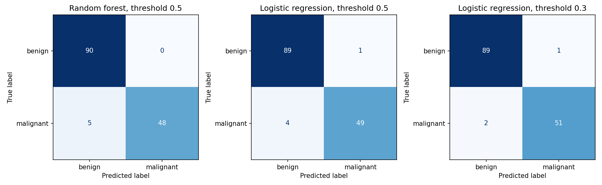

# Breast Cancer Diagnosis (Wisconsin)

**Course:** SE309 AI and Data Science for Innovation in Health Science · Fall 2026–27
**Topic code:** SE309-03   ·   **Working as:** Individual

> **Educational project only.** The models in this repository are not a diagnostic tool and must not be used to make decisions about real patients.

## Members

| Name | Student no. | GitHub username |
|---|---|---|
| Talha Tufan | 220201035 | @TalhaTufanN |

## What the project does

The project classifies breast tumours as benign or malignant from 30 cell-nucleus measurements taken from fine needle aspirate (FNA) images, using the public Breast Cancer Wisconsin (Diagnostic) data. It explores the strongly correlated features, compares at least two models with a majority-class baseline in Weka and Python, and reports confusion matrices with sensitivity and specificity. Special attention is given to false negatives — malignant tumours predicted as benign — because they are the most costly error. As an extension it tests feature selection and compares the models with a single-feature baseline.

## How to install and run

### Weka
Weka 3.8.7 was used.

1. Open Weka → Explorer → **Open file…** → `data/wdbc_train.arff`.
   (Do **not** use the `breast-cancer.arff` file that ships with Weka — it is a different dataset.)
2. To evaluate a saved model: Classify tab → **Supplied test set** → `data/wdbc_test.arff`, then right-click the result list → **Load model** → for example `weka/logistic_ridge05.model` → **Re-evaluate model on current test set**.
3. Settings used, with no filters and the class attribute `diagnosis`:
   - `rules.ZeroR` (baseline)
   - `functions.Logistic` with default settings, and with `-R 0.5` (main Weka model)
   - `trees.RandomForest -I 300 -S 42`
   - Test options: 10-fold cross-validation on the training file, and Supplied test set.

To repeat all the runs from the command line: `WEKA_JAR=/path/to/weka.jar bash weka/run_weka.sh`.

### Python / Colab
1. Open `notebooks/project.ipynb` in Google Colab: [](https://colab.research.google.com/github/TalhaTufanN/se309-breast-cancer-diagnosis/blob/main/notebooks/project.ipynb)
   (or **File → Open notebook → GitHub** and paste this repository's URL).
2. **Runtime → Run all.** The notebook loads the data from scikit-learn itself; no other step is needed.

To run locally instead: `pip install -r requirements.txt`, then open the notebook in Jupyter.
To recreate the CSV and ARFF files: `python data/make_data.py`.

## Example output

Results on the held-out test set (143 samples, 53 malignant). Malignant is the positive class; FN = malignant tumours predicted as benign.

| Model | Accuracy | Sensitivity | Specificity | AUC | FN | FP |
|---|---|---|---|---|---|---|
| Baseline (always benign) | 62.9% | 0.000 | 1.000 | 0.500 | 53 | 0 |
| Random forest, threshold 0.5 | 96.5% | 0.906 | 1.000 | 0.996 | 5 | 0 |
| Logistic regression, threshold 0.5 | 96.5% | 0.925 | 0.989 | 0.996 | 4 | 1 |
| **Logistic regression, threshold 0.3** (main model) | **97.9%** | **0.962** | **0.989** | **0.996** | **2** | **1** |

The threshold 0.3 was chosen on the training data only, to reduce missed cancers. Weka results for the same split are in `weka/` and in Section 7 of the notebook.



## Data

| Dataset | Source (link) | Size | Licence / terms of use |
|---|---|---|---|
| Breast Cancer Wisconsin (Diagnostic) | [UCI Machine Learning Repository](https://archive.ics.uci.edu/dataset/17/breast+cancer+wisconsin+diagnostic), also in scikit-learn | 569 × 30 features + label (357 benign, 212 malignant) | CC BY 4.0 |

> Only public or properly released data is used. No real patient records, and no identifiable health data uploaded to online tools.

A short **data note** (who, why, when/where, label, missingness, impossible values, timing, consent) is in the report and in Section 2 of the notebook.

## Folder structure

```
├── README.md
├── requirements.txt
├── data/
│   ├── make_data.py      # exports the scikit-learn data to CSV and ARFF
│   ├── wdbc.csv          # the data as CSV
│   ├── wdbc.arff         # all the data for Weka
│   ├── wdbc_train.arff   # the training split used in Weka and the notebook
│   └── wdbc_test.arff    # the test split used in Weka and the notebook
├── weka/                 # saved models (.model), result buffers (.txt), run_weka.sh
├── notebooks/
│   └── project.ipynb     # main notebook (from the course template)
├── images/               # figures used in the README and reports
├── reports/
│   └── final_report.pdf
└── video.md              # link to the presentation video
```

## Who did what

| Member | Main responsibilities | Main files / parts |
|---|---|---|
| @TalhaTufanN | All parts (individual project) | All files |

## External code, libraries and AI tools

| What | Used for | Where |
|---|---|---|
| scikit-learn | loading the data, models, evaluation | `data/make_data.py`, notebook |
| pandas, NumPy, Matplotlib | data handling and plots | notebook |
| Weka | models and evaluation without code | `weka/` |
| Claude (AI assistant) | drafting code and text, checking the data note against the sources, explaining methods | README, `data/make_data.py`, `weka/run_weka.sh`, notebook §1–§7, §10–§11 |

## Report and video

- Final report: [`reports/final_report.pdf`](reports/final_report.pdf)
- Presentation video: <link — added at the final>
